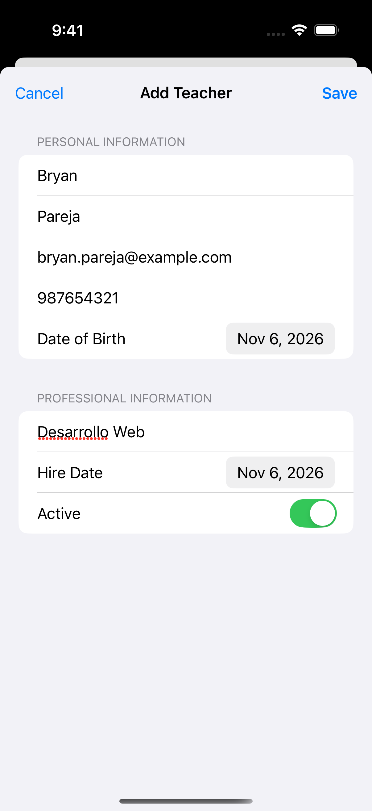
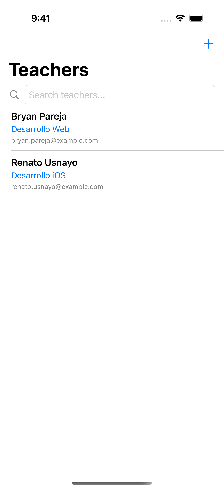
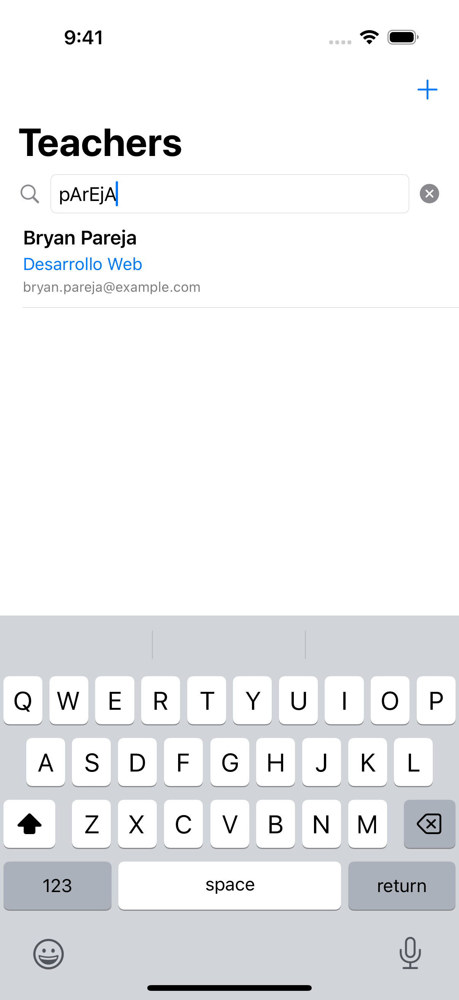
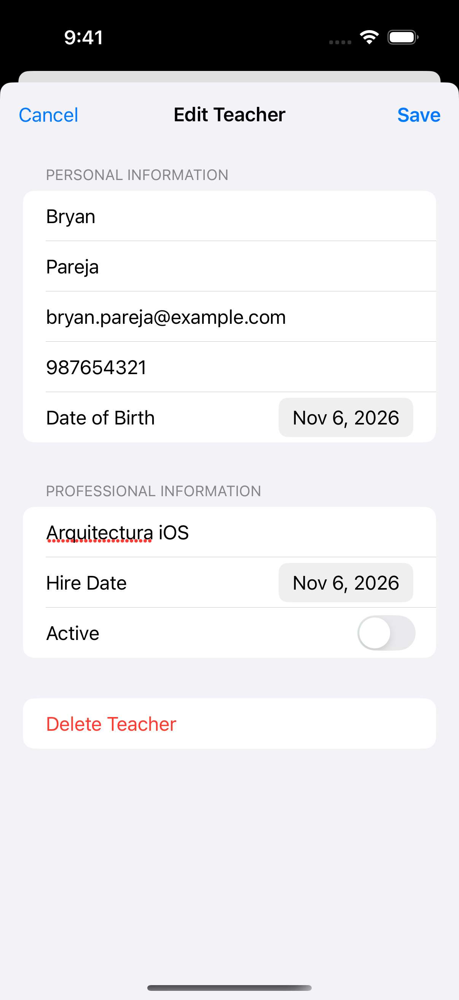
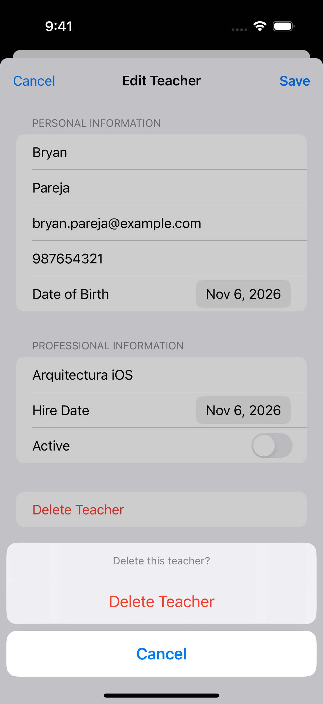
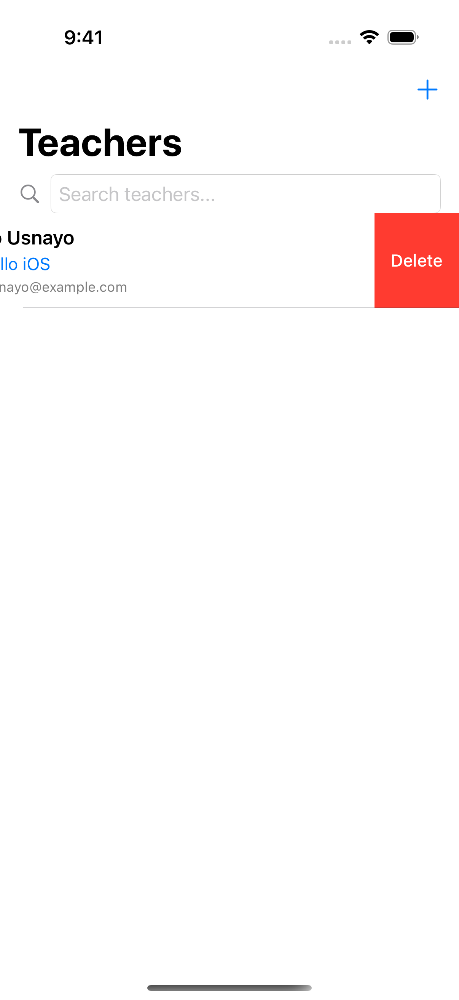

# PC3 — CRUD de docentes

Diego Calle · SwiftUI y SwiftData

Registro, listado, búsqueda, edición y eliminación de docentes. Incluye a Bryan Pareja y Renato Usnayo como datos iniciales. Los cambios se conservan al cerrar y abrir la app.

| Registro | Listado |
| --- | --- |
|  |  |

| Búsqueda | Edición |
| --- | --- |
|  |  |

| Confirmación de borrado | Borrado deslizando |
| --- | --- |
|  |  |

Capturas de la app ejecutándose en un iPhone 16 Pro simulado. Datos de ejemplo.

Abrir `apple_lab12_pract03_SwiftData.xcodeproj` en Xcode con un simulador de iOS 18.2 o posterior. Seleccionar el esquema `Docentes`.

Las pruebas de GitHub Actions se ejecutan manualmente.

[Prueba de funciones y persistencia](https://github.com/diegocalledc09/PC3-CalleDiego-swiftdata-docentes/actions/runs/42161991505) · [Proyecto base del profesor](https://github.com/jgomezz/apple_lab12_pract03_SwiftData)
